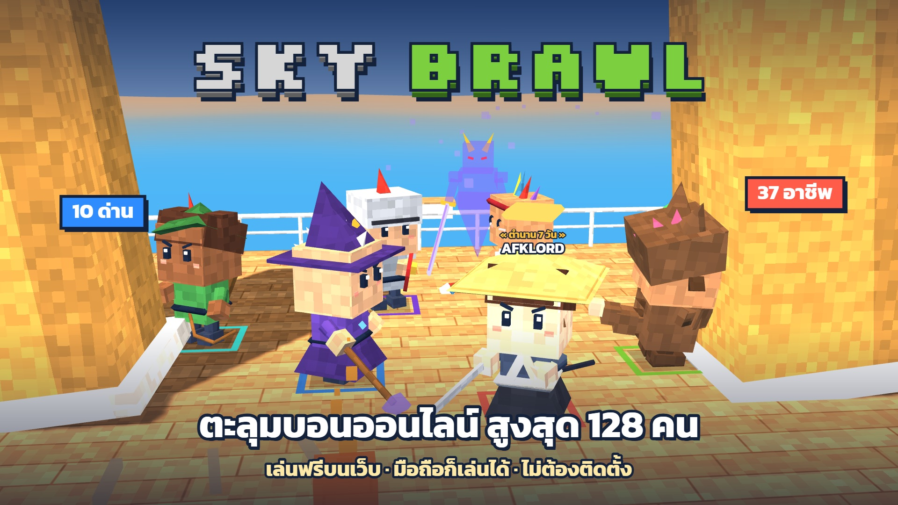
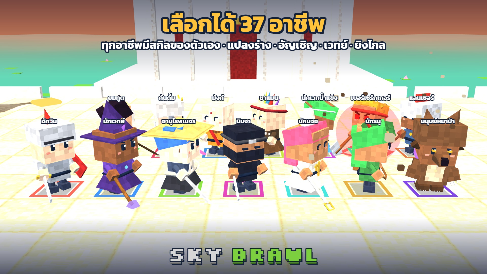
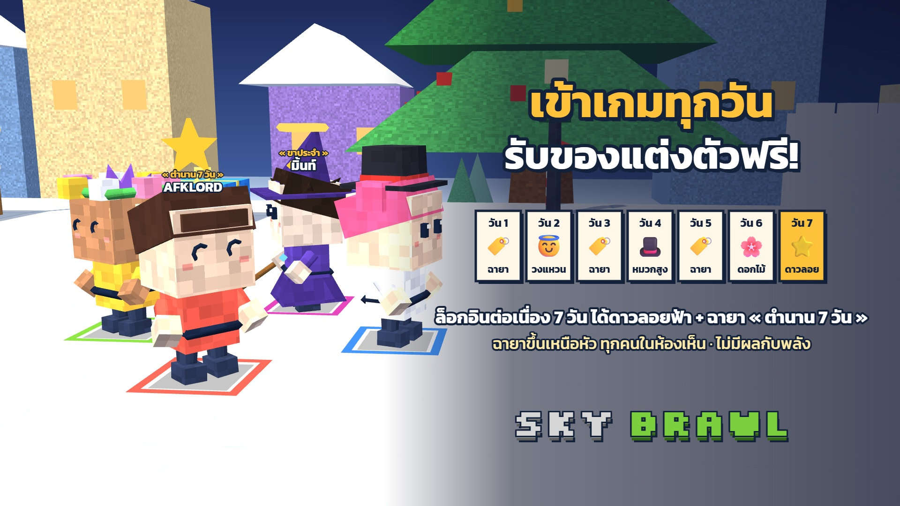
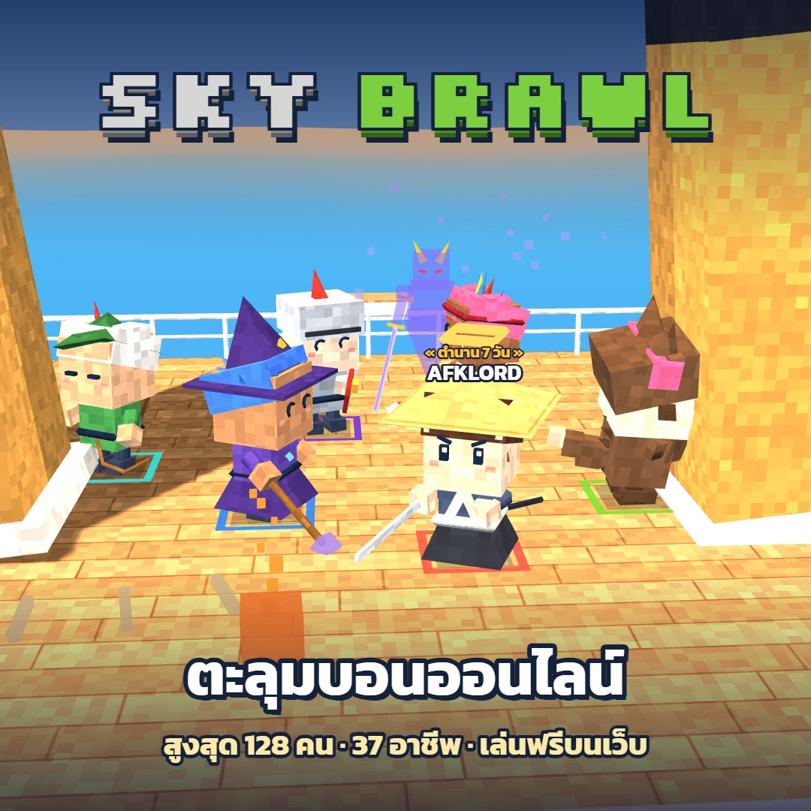

<div align="center">

# ⚔️ SKY BRAWL

**เกมตะลุมบอนออนไลน์ 3 มิติ เล่นฟรีบนเว็บ · มือถือก็เล่นได้ · ไม่ต้องติดตั้ง**

*A free browser brawler: 38 classes, up to 128 fighters, online rooms. Plays on phones and PCs.*

### [▶ เล่นเลย: sky-brawl.github.io](https://sky-brawl.github.io/)

[](https://sky-brawl.github.io/)

</div>

---

## 🎬 ตัวอย่างเกม


---

## ✨ จุดเด่น

| | |
|---|---|
| 🥊 **ต่อสู้มันส์ เล่นง่าย** | คอมโบ 3 จังหวะ กัน กระโดด หยิบของขว้าง ซัดคู่แข่งจนพลังหมด หรือกระเด็นตกเวที! มีปุ่มวิ่ง และเล็งอัตโนมัติ |
| 🧙 **38 อาชีพ** | ทุกอาชีพมีชุด อาวุธ คอมโบ และสกิลของตัวเอง ทั้งสายประชิด ยิงไกล เวทย์ ซัพพอร์ต แปลงร่าง และอัญเชิญ |
| 🏝️ **สูงสุด 128 คน** | ด่านเกาะลอยฟ้าขนาดใหญ่สำหรับสงครามกิล มีเนินสูงให้สายยิงไกล และพุ่มไม้ให้ซุ่มโจมตี |
| 🗺️ **11 ด่าน** | เรือไททานิก · วัดไทย · สยาม · สนามกิลวอ · ฮัลโลวีน · คริสต์มาส · ทะเลสาบน้ำแข็ง · โรงพยาบาล · เมืองญี่ปุ่นโบราณ · เกาะลอยฟ้า · 🌋 ภูเขาไฟระเบิด (พื้นถล่มลงลาวาทีละวง!) |
| 🎮 **3 โหมด** | ตะลุมบอน (ทุกคนคือศัตรู) · ทีมตีหิน (แดงปะทะน้ำเงิน) · ตีบอสยักษ์หิมะ |
| 🌐 **ออนไลน์กับเพื่อน** | สร้างห้อง ชวนเพื่อนผ่าน LINE / Facebook / X / QR code เลือกทีมได้ มีล็อบบี้และแชต |
| 🎁 **รางวัลรายวัน** | เข้าเกมทุกวัน รับหมวกพิเศษและฉายาเหนือหัว ครบ 7 วันได้ดาวลอยฟ้า + ฉายา « ตำนาน 7 วัน » |
| 🏆 **เลเวลและตารางอันดับ** | XP คิดฝั่งเซิร์ฟเวอร์ แข่งกันในอันดับเลเวล ชนะ และ KO · ผูกบัญชี Google เพื่อเล่นต่อได้ทุกเครื่อง |
| 👕 **แต่งตัวได้ตามใจ** | ผม ตา สีผิว ของบนหัว สีชุดอาชีพ (เปลี่ยนแค่หน้าตา ไม่มีผลกับพลัง) |
| 📘 **สอนเล่น 1 นาที** | มือใหม่กด "เล่นเลย" แล้วเริ่มจากบทสอนสั้นๆ ได้ทันที |

---

## 📸 ภาพในเกม

<table>
<tr>
<td></td>
<td></td>
</tr>
<tr>
<td align="center"><b>เลือกได้ 37 อาชีพ</b></td>
<td align="center"><b>สงครามกิล สูงสุด 128 คน</b></td>
</tr>
<tr>
<td></td>
<td></td>
</tr>
<tr>
<td align="center"><b>ล็อกอินรายวัน รับของแต่งตัวฟรี</b></td>
<td align="center"><b>ตะลุมบอนบนเรือไททานิก</b></td>
</tr>
</table>

---

## 🎮 วิธีเล่น

**มือถือ:** ลากนิ้วที่ครึ่งซ้ายของจอเพื่อเดิน ใช้ปุ่มบนจอด้านขวา (ต่อย · กระโดด · กัน · หยิบ · วิ่ง · สกิล · ล็อก) หมุนจอแนวนอนจะเห็นสนามกว้างกว่า

**คีย์บอร์ด**

| ผู้เล่น 1 | ผู้เล่น 2 (เครื่องเดียวกัน) | หน้าที่ |
|---|---|---|
| `W A S D` | `← ↑ → ↓` | เดิน |
| `F` | `,` หรือ `Num1` | ต่อย (กดรัว = คอมโบ 3 จังหวะ) |
| `G` / `Space` | `.` หรือ `Num2` | กระโดด |
| `H` (กดค้าง) | `/` หรือ `Num3` | กัน |
| `Shift` (กดค้าง) | `N` หรือ `Num7` (กดค้าง) | วิ่งเร็ว (มีแถบแรง) |
| `R` | `M` หรือ `Num0` | หยิบของ / ขว้างระเบิด |
| `E` | `;` หรือ `Num4` | สกิลอาชีพ |
| `Q` | `'` หรือ `Num6` | ล็อกเป้า (กดซ้ำ = สลับเป้า) |

ปรับมุมกล้องด้วย `-` `=` หรือล้อเมาส์ · `Esc` เมนู · `X` ดู hitbox

---

## 🛠️ สำหรับนักพัฒนา

เกมเป็นเว็บธรรมดา ไม่มีขั้นตอน build · ตั้งแต่ 1.6.0 โค้ดแยกเป็นไฟล์ย่อยตามหัวข้อในโฟลเดอร์ `js/` ดูว่าไฟล์ไหนทำอะไรได้ที่ [`js/README.md`](js/README.md)

| ไฟล์ | หน้าที่ |
|---|---|
| `index.html` | โครงหน้าเว็บ (เมนู ปุ่ม) + รายการไฟล์โค้ดตามลำดับโหลด |
| `style.css` | หน้าตาเมนูและ HUD |
| `js/` | โค้ดเกม แยกตามหัวข้อ (อาชีพ ด่าน บอท ออนไลน์ ฯลฯ) |
| `config.js` | ค่าที่ปรับได้โดยไม่ต้องแก้โค้ด: เลือด ความเร็ว คูลดาวน์/ดาเมจของสกิล เปิด-ปิดอาชีพ |
| `og.png` | รูปปกตอนแชร์ลิงก์ |
| `supabase-setup.sql` | ตารางโปรไฟล์ + แชตล็อบบี้ |
| `supabase-levels.sql` | เลเวล + ตารางอันดับ (`record_match`) |
| `supabase-daily.sql` | รางวัลล็อกอินรายวัน (`daily_status`, `claim_daily`) |
| `HANDOFF.md` | เอกสารโครงสร้างโค้ดและวิธีทำงานต่อ |
| `templates/` | แบบฟอร์มเสนออาชีพใหม่ + ตัวอย่าง + ฟอร์ม GitHub Issue |
| `DEVLOG.md` | บันทึกการเปลี่ยนแปลงแต่ละเวอร์ชัน |
| `promo/` | ภาพและวิดีโอโปรโมต |

**เทคโนโลยี:** [Three.js r128](https://threejs.org/) (กราฟิก) · [PeerJS](https://peerjs.com/) (ออนไลน์แบบ host คำนวณเกม) · [Supabase](https://supabase.com/) (บัญชี ล็อบบี้ แชต เลเวล รางวัลรายวัน) · Web Audio (เสียงสังเคราะห์ทั้งหมด ไม่มีไฟล์เสียง)

**รันบนเครื่อง:** เปิดโฟลเดอร์นี้ด้วยเว็บเซิร์ฟเวอร์ใดก็ได้ เช่น

```bash
python -m http.server 8000
```

แล้วเข้า `http://localhost:8000/`

**ตั้งค่า Supabase (ถ้าใช้โปรเจกต์ของตัวเอง):** เปิด SQL Editor แล้วรัน `supabase-setup.sql` → `supabase-levels.sql` → `supabase-daily.sql` ตามลำดับ (รันซ้ำได้) แล้วแก้ `SUPA_URL` / `SUPA_KEY` ใน `index.html` เป็นของโปรเจกต์คุณ ในโค้ดใส่ได้แค่ **anon key** เท่านั้น ห้ามใส่ `service_role` key เด็ดขาด สิทธิ์การเขียนข้อมูลทั้งหมดคุมด้วย Row Level Security และฟังก์ชันฝั่งเซิร์ฟเวอร์

## 💡 อยากให้มีอาชีพใหม่?

กรอก [แบบฟอร์มเสนออาชีพใหม่](templates/NEW_CLASS_TEMPLATE.md) (ดู[ตัวอย่างยมทูต](templates/EXAMPLE_REAPER.md)) แล้วส่งมาเป็น Issue ได้เลย ช่องไหนไม่แน่ใจเว้นว่างไว้ ทีมจะปรับสมดุลให้

---

<div align="center">

**ชวนเพื่อนมาตะลุมบอนกัน!** 👉 **[sky-brawl.github.io](https://sky-brawl.github.io/)**

`#SkyBrawl` `#เกมออนไลน์` `#เกมฟรี` `#เกมมือถือ`

</div>
