<div align="center">

# ⚔️ SKY BRAWL

### ตะลุมบอนบล็อก 3 มิติ เล่นฟรีบนเว็บ · มือถือก็เล่นได้ · ไม่ต้องติดตั้ง


## [▶ เล่นเลย: sky-brawl.github.io](https://sky-brawl.github.io/)

[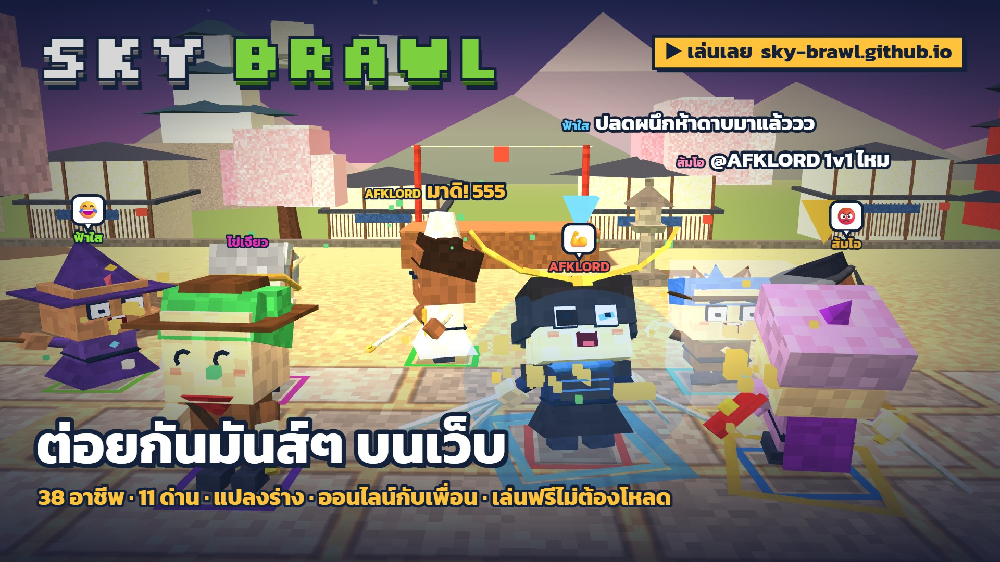](https://sky-brawl.github.io/)

*A free browser brawler with 38 classes, up to 128 fighters, online rooms with friends, and bots that chat back. Plays on phones and PCs, no install.*

[🆕 อัปเดตล่าสุด](#-อัปเดตล่าสุด) · [🚀 เริ่มเล่น](#-เริ่มเล่นใน-30-วินาที) · [✨ จุดเด่น](#-จุดเด่น) · [🧙 อาชีพ](#-อาชีพทั้งหมด--รีวิว) · [🎮 ปุ่มควบคุม](#-ปุ่มควบคุม) · [❓ คำถามที่พบบ่อย](#-คำถามที่พบบ่อย)

</div>

---

## 🆕 อัปเดตล่าสุด

<div align="center">

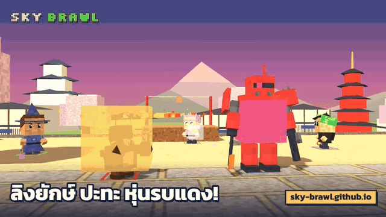

**ลิงยักษ์ ปะทะ หุ่นรบแดง!**

</div>

| เวอร์ชัน | มีอะไรใหม่ |
|---|---|
| **1.13** | 🎬 **ไฮไลต์ท้ายแมตช์** เล่นช็อตเด็ดย้อนหลังแบบสโลว์ · 🎥 บันทึกเป็นคลิปแล้วแชร์ได้ทันที |
| **1.12** | 📋 **ภารกิจรายวัน** วันละ 3 ข้อ รับ XP + โบนัสครบ 3 ข้อ + ฉายาใหม่ |
| **1.11** | 🎥 เริ่มแมตช์ด้วยกล้องมุมกว้างทุกครั้ง · **หมุนกล้องได้** (Z / C, คลิกขวาลาก, ปุ่ม ⟲ ⟳ บนมือถือ) ทิศเดินหมุนตามกล้อง |
| **1.10** | 🧪 **ยาวานรยักษ์** แปลงร่างเป็นกอริลล่ายักษ์ · 🤖 **หุ่นรบแดง** ขึ้นขี่ได้ ฟันขวานความร้อน ยิงปืนกล · 📜 ข้อมูลลิขสิทธิ์และเครดิต |
| **1.9** | 💬 **แชทวิ่งบนจอแบบ Niconico** · บอทพิมพ์แชท ตอบเรา ถามกลับ และรับคำท้า 1v1 จริง (ประโยคกว่า 200 แบบ) |
| **1.8** | 😂 อีโมตเหนือหัว 8 แบบ · 🏆 ท่าฉลองตอนชนะ · บอทส่งอีโมตเหมือนคน |
| **1.7** | 🌋 ด่านใหม่ **ภูเขาไฟระเบิด** พื้นถล่มลงลาวาทีละวง · 😵 หน้าตัวละครเปลี่ยนตามอารมณ์ (ตาปูด อ้าปาก) |
| **1.6** | 🐉 อาชีพใหม่ **เบียวมังกร** ปลดผนึกห้าดาบ ออร่าสีฟ้า |

ดูทุกเวอร์ชันได้ที่ [DEVLOG.md](DEVLOG.md)

---

## 🚀 เริ่มเล่นใน 30 วินาที

1. เปิด **[sky-brawl.github.io](https://sky-brawl.github.io/)** บนคอมหรือมือถือ (แนะนำ Chrome, Edge, Safari)
2. ตั้งชื่อ แล้วกด **▶ เล่นเลย** ได้สู้กับบอททันที หรือกด **📘 สอนเล่น 1 นาที** ก่อนก็ได้
3. อยากเล่นกับเพื่อน กด **เล่นออนไลน์** → สร้างห้อง → ส่งลิงก์ให้เพื่อนทาง LINE / Facebook / X / QR code
4. ไม่ต้องสมัคร ไม่ต้องโหลด · ผูกบัญชี Google ได้ถ้าอยากเก็บเลเวลไว้เล่นต่อทุกเครื่อง

---

## 🎬 ตัวอย่างเกม

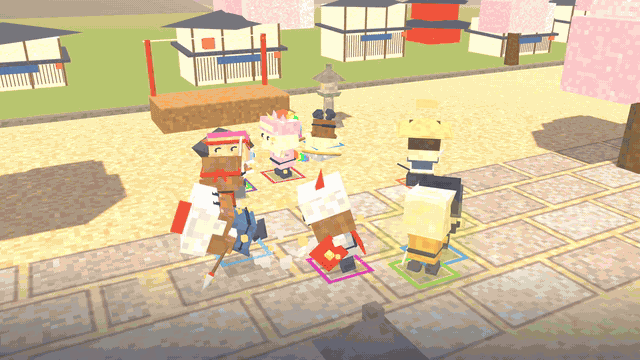

---

## ✨ จุดเด่น

| | |
|---|---|
| 🥊 **ต่อสู้มันส์ เล่นง่าย** | คอมโบ 3 จังหวะ กัน กระโดด หยิบของขว้าง ซัดคู่แข่งจนพลังหมด หรือกระเด็นตกเวที! มีปุ่มวิ่งและเล็งอัตโนมัติ |
| 🧙 **38 อาชีพ** | ทุกอาชีพมีชุด อาวุธ คอมโบ และสกิลของตัวเอง ทั้งสายประชิด ยิงไกล เวทย์ ซัพพอร์ต แปลงร่าง และอัญเชิญ ([ดูรีวิวทุกอาชีพ](#-อาชีพทั้งหมด--รีวิว)) |
| 🧪 **ยาวานรยักษ์ + หุ่นรบแดง** | เก็บยาแล้วกลายเป็นกอริลล่ายักษ์ หรือปีนขึ้นหุ่นรบแดงตาเดียว ฟันขวาน ยิงปืนกล ([รายละเอียด](#-ไอเทมและพลังพิเศษ)) |
| 🏝️ **สูงสุด 128 คน** | ด่านเกาะลอยฟ้าขนาดใหญ่สำหรับสงครามกิล มีเนินสูงให้สายยิงไกล และพุ่มไม้ให้ซุ่มโจมตี |
| 🗺️ **11 ด่าน** | เรือไททานิก · วัดไทย · สยาม · สนามกิลวอ · ฮัลโลวีน · คริสต์มาส · ทะเลสาบน้ำแข็ง · โรงพยาบาล · เมืองญี่ปุ่นโบราณ · เกาะลอยฟ้า · ภูเขาไฟระเบิด |
| 🎮 **3 โหมด** | ตะลุมบอน (ทุกคนคือศัตรู) · ทีมตีหิน (แดงปะทะน้ำเงิน) · ตีบอสยักษ์หิมะ |
| 🌐 **ออนไลน์กับเพื่อน** | สร้างห้อง ชวนเพื่อนด้วยลิงก์หรือ QR เลือกทีมได้ มีล็อบบี้และแชต บอทเติมที่ว่างให้อัตโนมัติ |
| 💬 **แชทวิ่งบนจอ + บอทคุยได้** | กด Enter พิมพ์ ข้อความวิ่งข้ามจอให้ทุกคนเห็น บอทพิมพ์แซว ตอบคำถาม ถามกลับ และรับคำท้า 1v1 |
| 😂 **อีโมตและท่าฉลอง** | อีโมตเหนือหัว 8 แบบ หน้าตาเปลี่ยนตามอารมณ์ และท่าฉลองตอนชนะ |
| 🎥 **กล้องหมุนได้** | ซูมใกล้-ไกล 5 ระดับ และหมุนกล้องรอบตัวได้ 360° |
| 🎬 **ไฮไลต์ + แชร์คลิป** | จบแมตช์ดูช็อตเด็ดย้อนหลังแบบสโลว์ตอน KO แล้วกดบันทึกเป็นวิดีโอ แชร์ลง TikTok / Facebook / LINE ได้เลย |
| 📋 **ภารกิจรายวัน** | วันละ 3 ภารกิจ (ง่าย · กลาง · ยาก) รับ XP ทำครบรับโบนัส และปลดล็อกฉายา « นักล่าภารกิจ » · มีอาชีพประจำวันให้ลอง |
| 🎁 **รางวัลรายวัน** | เข้าเกมทุกวัน รับหมวกพิเศษและฉายาเหนือหัว ครบ 7 วันได้ดาวลอยฟ้า + ฉายา « ตำนาน 7 วัน » |
| 🏆 **เลเวลและตารางอันดับ** | XP คิดฝั่งเซิร์ฟเวอร์ แข่งกันในอันดับเลเวล ชนะ และ KO |
| 👕 **แต่งตัวได้ตามใจ** | ผม ตา สีผิว ของบนหัว สีชุดอาชีพ (เปลี่ยนแค่หน้าตา ไม่มีผลกับพลัง) |

---

## 📸 ภาพในเกม

<table>
<tr>
<td>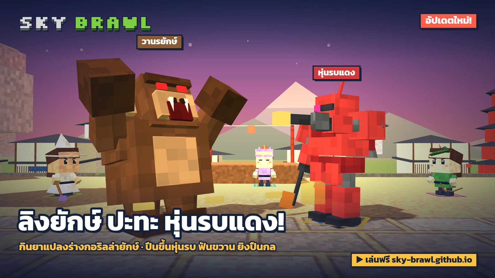</td>
<td>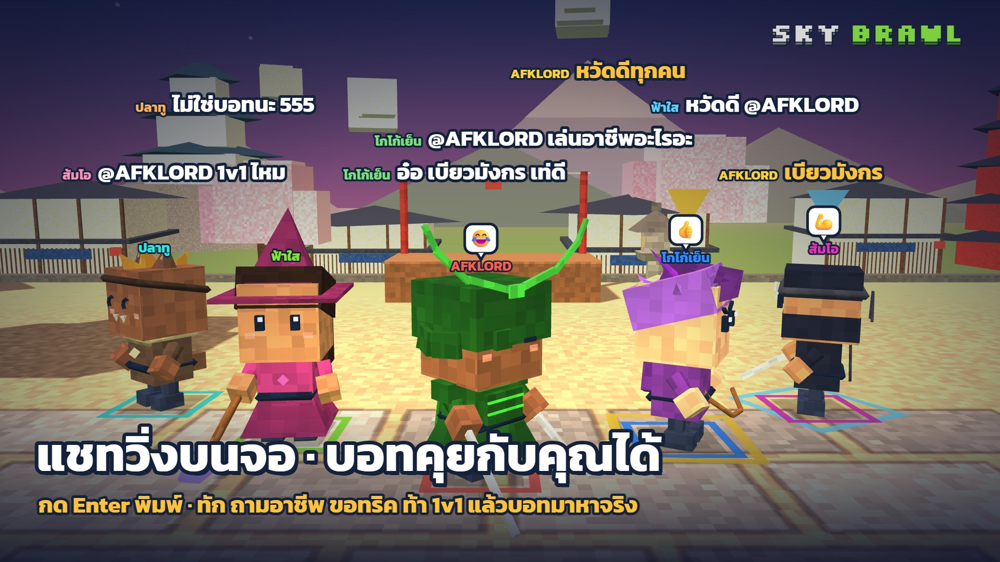</td>
</tr>
<tr>
<td align="center"><b>ลิงยักษ์ ปะทะ หุ่นรบแดง</b></td>
<td align="center"><b>แชทวิ่งบนจอ บอทคุยกับคุณได้</b></td>
</tr>
<tr>
<td>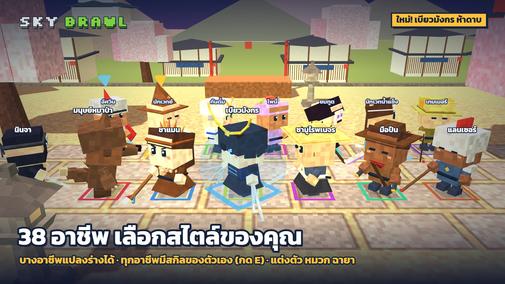</td>
<td>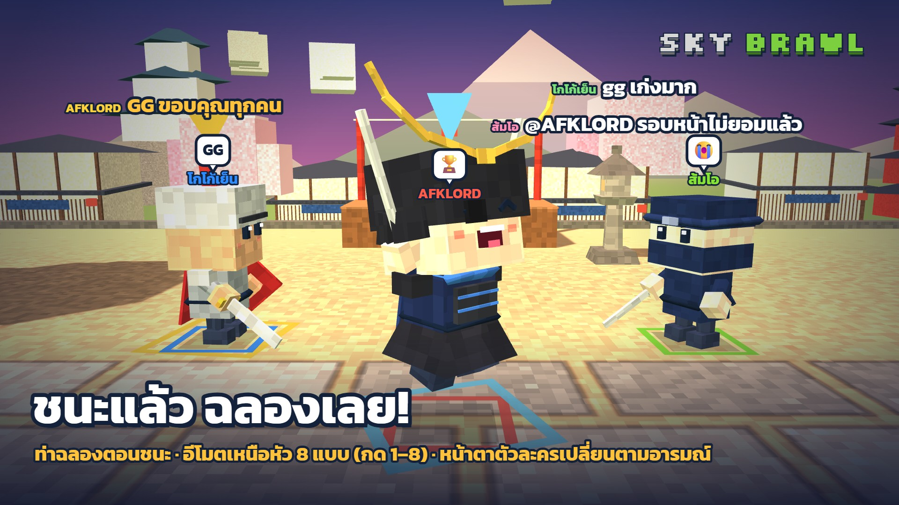</td>
</tr>
<tr>
<td align="center"><b>38 อาชีพ บางอาชีพแปลงร่างได้</b></td>
<td align="center"><b>ชนะแล้วฉลอง + อีโมตเหนือหัว</b></td>
</tr>
<tr>
<td>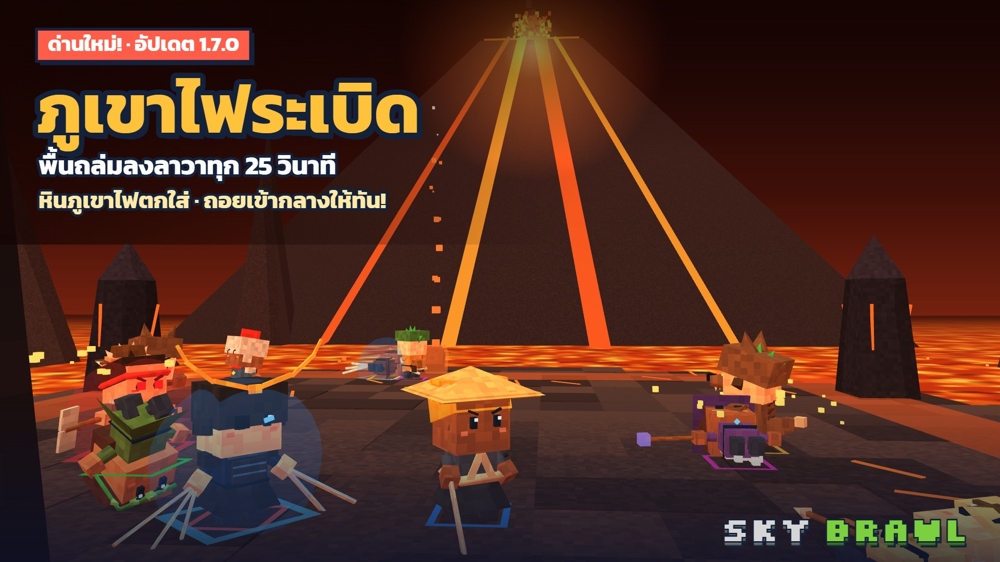</td>
<td>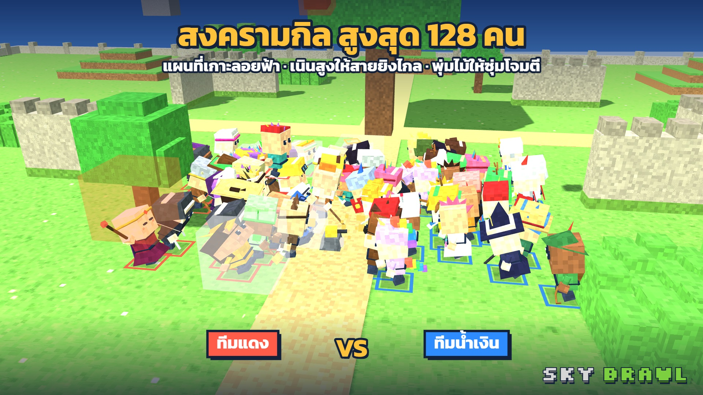</td>
</tr>
<tr>
<td align="center"><b>ด่านภูเขาไฟ พื้นถล่มลงลาวา</b></td>
<td align="center"><b>สงครามกิล สูงสุด 128 คน</b></td>
</tr>
</table>

---

## 🧪 ไอเทมและพลังพิเศษ

ไอเทมตกลงมาจากฟ้าเรื่อยๆ ระหว่างสู้ เดินไปหยิบด้วยปุ่ม **R** (หรือกดต่อยข้างๆ ของ)

| ไอเทม | ใช้ทำอะไร |
|---|---|
| 🔨 **ค้อน** | ทุบแรง ใช้ได้ 7 ครั้ง ท่าที่ 2 ทะลุการกัน |
| 🔫 **ปืนพก / ลูกซอง** | ยิงจากระยะไกล ปืนพก 10 นัด ลูกซอง 5 นัด |
| 💣 **ระเบิด** | หยิบแล้วกด R อีกครั้งเพื่อขว้าง ระเบิดเป็นวง |
| 🍙 **ข้าวปั้น** | เดินทับเพื่อฟื้นเลือด |
| 🧪 **ยาวานรยักษ์** | เดินทับแล้ว **กลายเป็นกอริลล่ายักษ์ 10 วินาที** ตัวใหญ่ 2.3 เท่า โดนดาเมจครึ่งเดียว โดนตีไม่สะดุ้ง คอมโบทุบพื้น → ตบกวาด → ทุบสองมือ · **E** พ่นลำแสงจากปาก |

**🤖 หุ่นรบแดง** ตกลงมาในแมพหลังเริ่มสู้ 15 วินาที เดินไปใกล้แล้วกด **R** เพื่อขึ้นขี่

| | |
|---|---|
| ⏱️ เวลา | ขี่ได้ไม่จำกัด จนกว่าหุ่นจะพังหรือกด R ลงเอง |
| ❤️ เลือดหุ่น | 100 (โดนตีแล้วหักจากหุ่น ไม่หักคนขี่) |
| 🪓 **F** | ขวานความร้อน คอมโบ 2 จังหวะ ท่าที่ 2 ทะลุการกัน |
| 🔫 **E** | ปืนกลยิงรัว คูลดาวน์ 5 วินาที |
| 💥 หุ่นพัง | ระเบิดใส่คนรอบตัว คนขี่กระเด็นออก แล้วตัวใหม่ลงมาใน 30 วินาที |

---

## 🧙 อาชีพทั้งหมด + รีวิว

ทั้งหมด 38 อาชีพ แต่ละ GIF ถ่ายจากเกมจริง เป็นคอมโบ 3 จังหวะ ตามด้วยสกิล <kbd>E</kbd> · ความยาก ★ = มือใหม่เล่นได้ทันที, ★★★ = ต้องฝึก

**มือใหม่เริ่มที่นี่:** อัศวิน · นักรบ · นักเวทย์ · นักบวช · นักธนู · มือปืน · โพนี่ · พ่อค้า · เทควันโด · ทหาร · ชาแมน · แลนเซอร์

<details open>
<summary><b>⚔️ ระยะใกล้</b> (15 อาชีพ)</summary>

<table>
<tr>
<td width="260">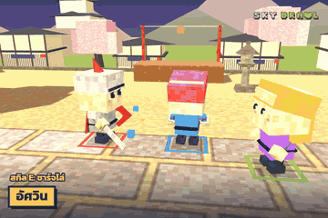</td>
<td>

**อัศวิน** · ระยะใกล้ · ความยาก ★☆☆

🌀 **สกิล E:** พุ่งชาร์จด้วยโล่ ทะลุการกัน<br>
👍 ตีง่าย ชาร์จทะลุการกัน เปิดเกมใส่คนที่ยืนกันได้<br>
👎 ไม่มีท่าระยะไกล โดนตอดจากไกลแล้วลำบาก<br>
💡 เก็บชาร์จไว้ใช้ตอนศัตรูกด H กัน แล้วต่อคอมโบทันที

</td>
</tr>
<tr>
<td width="260">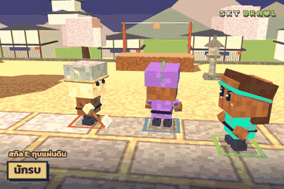</td>
<td>

**นักรบ** · ระยะใกล้ · ความยาก ★☆☆

🌀 **สกิล E:** ทุบพื้นให้ทุกคนรอบตัวลอย<br>
👍 สกิลวงรอบตัว เหมาะโดนรุม ใช้ง่ายมาก<br>
👎 สกิลระยะสั้น ต้องเข้าไปกลางวงเอง<br>
💡 วิ่ง (Shift) เข้ากลางกลุ่มแล้วกด E ทุกคนลอยพร้อมกัน

</td>
</tr>
<tr>
<td width="260">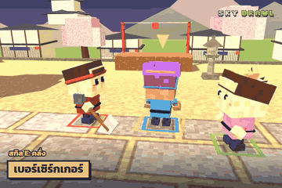</td>
<td>

**เบอร์เซิร์กเกอร์** · ระยะใกล้ · ความยาก ★★☆

🌀 **สกิล E:** เสียพลัง 8 แล้วคลั่ง 6 วิ ดาเมจ ×1.5 ตีเร็ว ดูดเลือด<br>
👍 ช่วงคลั่งแรงที่สุดในเกมระยะประชิด ตีแล้วเลือดเด้งกลับ<br>
👎 คูลดาวน์ยาว 15 วิ และเสียเลือดก่อนเปิด<br>
💡 เปิดคลั่งตอนอยู่ติดศัตรูแล้วเท่านั้น อย่าเปิดแล้ววิ่งไล่

</td>
</tr>
<tr>
<td width="260">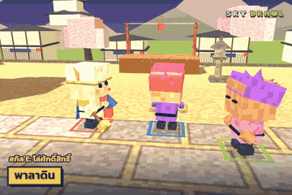</td>
<td>

**พาลาดิน** · ระยะใกล้ · ความยาก ★★☆

🌀 **สกิล E:** อมตะ 1.6 วิ ฟื้นพลัง 15 ผลักคนรอบตัว<br>
👍 สกิลกู้สถานการณ์ เอาตัวรอดตอนโดนรุมได้ดี<br>
👎 ดาเมจกลางๆ สกิลไม่ใช่ท่าโจมตีหลัก<br>
💡 กดตอนเลือดน้อยหรือโดนคอมโบ เป็นทั้งฮีลและหลบในปุ่มเดียว

</td>
</tr>
<tr>
<td width="260">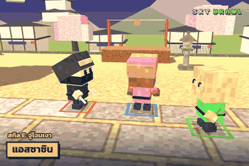</td>
<td>

**แอสซาซิน** · ระยะใกล้ · ความยาก ★★★

🌀 **สกิล E:** วาร์ปไปข้างหลังศัตรูที่ใกล้ที่สุดแล้วแทง<br>
👍 เข้าหาเป้าได้ทันที ตัดหลังสายยิงไกล<br>
👎 ยากสุดในสายประชิด วาร์ปเข้าไปกลางกลุ่มแล้วโดนรุมได้<br>
💡 เล็งคนที่อยู่ห่างจากกลุ่ม วาร์ปแทงแล้วต่อคอมโบให้ตกเวที

</td>
</tr>
<tr>
<td width="260">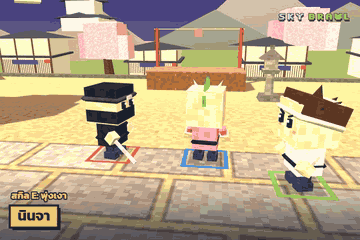</td>
<td>

**นินจา** · ระยะใกล้ · ความยาก ★★☆

🌀 **สกิล E:** พุ่งทะลุไปข้างหน้า 6 ช่อง ฟันทุกคนที่ผ่าน<br>
👍 คล่องตัว ใช้สกิลทั้งโจมตีและหนีได้<br>
👎 พุ่งผิดทิศอาจตกเวทีเอง<br>
💡 หันให้ถูกทางก่อนกด E โดยเฉพาะตอนอยู่ใกล้ขอบ

</td>
</tr>
<tr>
<td width="260">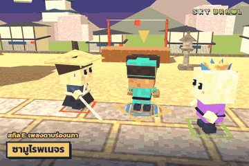</td>
<td>

**ซามูไรพเนจร** · ระยะใกล้ · ความยาก ★★☆

🌀 **สกิล E:** คลื่นดาบจันทร์เสี้ยวพุ่งไกลราว 9 ช่อง ทะลุทุกคน<br>
👍 สายดาบที่ตีได้ไกล ท่าต่อยที่ 3 ก็ปล่อยคลื่นสั้น<br>
👎 ต้องเล็งแนวให้ดี คลื่นวิ่งตรงอย่างเดียว<br>
💡 ยืนให้ศัตรูหลายคนอยู่แนวเดียวกันแล้วปล่อยคลื่น

</td>
</tr>
<tr>
<td width="260">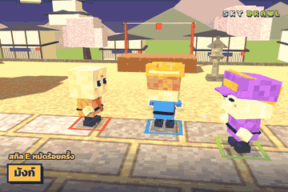</td>
<td>

**มังก์** · ระยะใกล้ · ความยาก ★★☆

🌀 **สกิล E:** รัวหมัด 6 ครั้งติดกัน<br>
👍 ดาเมจระยะประชิดสูง ติดคอมโบแน่น<br>
👎 ระยะสั้นมาก (1.8 ช่อง) ต้องตัวติดกัน<br>
💡 ต่อยให้ศัตรูมึนก่อนแล้วค่อยกด E ให้โดนครบทั้ง 6 หมัด

</td>
</tr>
<tr>
<td width="260">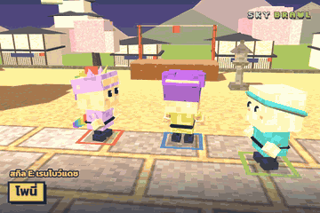</td>
<td>

**โพนี่** · ระยะใกล้ · ความยาก ★☆☆

🌀 **สกิล E:** พุ่งทะยานทิ้งสายรุ้ง ชนทุกคนที่ขวาง<br>
👍 น่ารัก พุ่งชนได้หลายคน เล่นง่าย<br>
👎 พุ่งแล้วตำแหน่งเปลี่ยนเยอะ อาจไปไกลจากเป้า<br>
💡 ใช้พุ่งไล่คนที่หนี หรือพุ่งหนีตอนเลือดน้อย

</td>
</tr>
<tr>
<td width="260">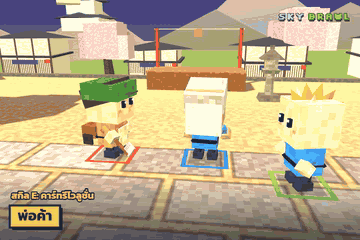</td>
<td>

**พ่อค้า** · ระยะใกล้ · ความยาก ★☆☆

🌀 **สกิล E:** เหวี่ยงรถเข็นรอบตัว ซัดทุกคนกระเด็นไกล<br>
👍 ผลักรอบทิศ ใช้ง่าย สนุก<br>
👎 ระยะสั้น ต้องเข้าไปกลางกลุ่ม<br>
💡 เหวี่ยงตอนยืนใกล้ขอบเวที ศัตรูกระเด็นตกได้ง่าย

</td>
</tr>
<tr>
<td width="260">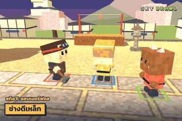</td>
<td>

**ช่างตีเหล็ก** · ระยะใกล้ · ความยาก ★★☆

🌀 **สกิล E:** ทุบค้อนลงพื้น ทุกคนในวงมึน 1.6 วิ<br>
👍 มึนนานกว่ารากของดรูอิด ต่อคอมโบได้ยาว<br>
👎 ทุบข้างหน้าเท่านั้น ต้องหันให้ถูก<br>
💡 ทุบแล้วต่อคอมโบ 3 จังหวะทันที คนมึนกันไม่ได้

</td>
</tr>
<tr>
<td width="260">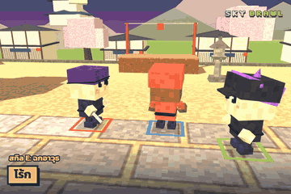</td>
<td>

**โร้ก** · ระยะใกล้ · ความยาก ★★★

🌀 **สกิล E:** พุ่งฉก ขโมยอาวุธและดูดพลัง 6<br>
👍 แย่งอาวุธ (ปืน ค้อน) จากศัตรูมาใช้เอง<br>
👎 ยาก ดาเมจตัวเองไม่สูง ต้องเล่นจังหวะ<br>
💡 เล็งคนที่ถือปืนหรือค้อนอยู่ ฉกมาแล้วใช้ยิงคืน

</td>
</tr>
<tr>
<td width="260">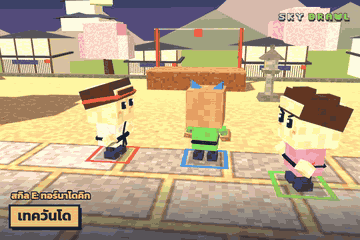</td>
<td>

**เทควันโด** · ระยะใกล้ · ความยาก ★☆☆

🌀 **สกิล E:** เตะหมุนเป็นพายุ เตะทุกคนรอบตัวลอย<br>
👍 คูลดาวน์สั้น 6 วิ ใช้บ่อยได้ เล่นง่าย<br>
👎 ระยะรอบตัวแคบ<br>
💡 เตะให้ลอยแล้วกระโดดตามไปต่อยกลางอากาศ

</td>
</tr>
<tr>
<td width="260">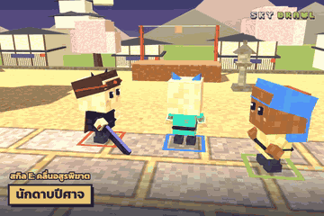</td>
<td>

**นักดาบปีศาจ** · ระยะใกล้ · ความยาก ★★☆

🌀 **สกิล E:** ฟันทุกครั้งปล่อยคลื่นดำ สกิลคลื่นอสูรใหญ่ 3 สาย<br>
👍 ตีธรรมดาก็ได้ระยะไกล (คลื่นดำ) สกิลทะลุหลายคน<br>
👎 ต้องหันหาเป้าตลอด คลื่นวิ่งตามทิศที่หัน<br>
💡 ยืนห่างนิดหน่อยแล้วฟันรัว ให้คลื่นดำตอดศัตรูก่อนเข้าประชิด

</td>
</tr>
<tr>
<td width="260">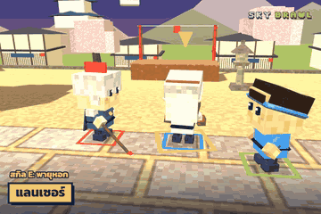</td>
<td>

**แลนเซอร์** · ระยะใกล้ · ความยาก ★☆☆

🌀 **สกิล E:** แทงหอกรัวเป็นแนวยาว 6.5 ช่อง ครั้งสุดท้ายกระเด็นไกล<br>
👍 ระยะดีกว่าสายประชิดทั่วไป ใช้ง่าย<br>
👎 แทงเป็นแนวตรง ต้องหันให้ถูก<br>
💡 ระหว่างแทงยังหันตามจอยได้ช้าๆ ใช้กวาดตามเป้าที่ขยับ

</td>
</tr>
</table>

</details>

<details>
<summary><b>🏹 ระยะไกล</b> (7 อาชีพ)</summary>

<table>
<tr>
<td width="260">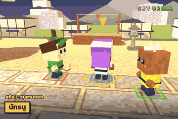</td>
<td>

**นักธนู** · ระยะไกล · ความยาก ★☆☆

🌀 **สกิล E:** ยิงธนู 3 ดอกพร้อมกัน ระยะไกล<br>
👍 ระยะไกลที่สุดกลุ่มหนึ่ง คูลดาวน์สั้น 5 วิ<br>
👎 ระยะใกล้อ่อน โดนพุ่งเข้าหาแล้วลำบาก<br>
💡 ยืนบนที่สูงหรือหลังเพื่อน แล้วยิงสามดอกเป็นพัดใส่กลุ่ม

</td>
</tr>
<tr>
<td width="260">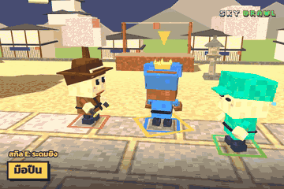</td>
<td>

**มือปืน** · ระยะไกล · ความยาก ★☆☆

🌀 **สกิล E:** ยิงรัว 6 นัดใส่ข้างหน้า<br>
👍 ยิงไกล ตีง่ายสุดในสายยิง เหมาะมือใหม่<br>
👎 กระสุนเบา ศัตรูกันได้ (H)<br>
💡 ยิงใส่คนที่กำลังวิ่งหรือกำลังตีคนอื่นอยู่ จะกันไม่ทัน

</td>
</tr>
<tr>
<td width="260">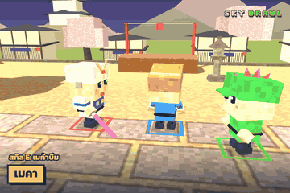</td>
<td>

**เมคา** · ระยะไกล · ความยาก ★★☆

🌀 **สกิล E:** ยิงบีมยักษ์ทะลุทุกคนในแนวยิง ไกล 12 ช่อง<br>
👍 บีมแรงและไกล โดนหลายคนพร้อมกัน<br>
👎 คูลดาวน์ 10 วิ ต้องเล็งแนวให้แม่น<br>
💡 รอให้ศัตรูต่อแถวกันแล้วยิงทีเดียวหลายคน

</td>
</tr>
<tr>
<td width="260">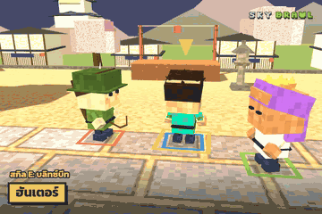</td>
<td>

**ฮันเตอร์** · ระยะไกล · ความยาก ★★☆

🌀 **สกิล E:** ปล่อยเหยี่ยวไล่ศัตรูที่ใกล้ที่สุด จิกแล้วระเบิด<br>
👍 ไม่ต้องเล็ง เหยี่ยวตามเอง ไกล 13 ช่อง<br>
👎 ดาเมจเหยี่ยวไม่สูง<br>
💡 ปล่อยเหยี่ยวแล้วยิงธนูตามไปซ้ำ ศัตรูหลบสองอย่างพร้อมกันยาก

</td>
</tr>
<tr>
<td width="260">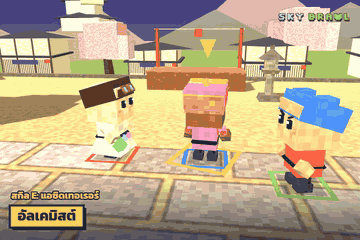</td>
<td>

**อัลเคมิสต์** · ระยะไกล · ความยาก ★★☆

🌀 **สกิล E:** ขว้างขวดกรดวงโค้ง ระเบิดวงกว้าง 7×7 ทะลุการกัน<br>
👍 วงระเบิดใหญ่มาก กันไม่ได้<br>
👎 ขวดลอยเป็นวงโค้ง ต้องกะระยะ<br>
💡 ขว้างใส่คนที่ยืนกัน (H) ทะลุการกันเข้าไปเลย

</td>
</tr>
<tr>
<td width="260">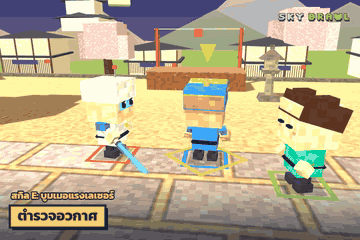</td>
<td>

**ตำรวจอวกาศ** · ระยะไกล · ความยาก ★★☆

🌀 **สกิล E:** ขว้างดาบเลเซอร์บูมเมอแรง ฟันทั้งขาไปขากลับ<br>
👍 โดนสองรอบต่อการขว้างหนึ่งครั้ง<br>
👎 ดาบต้องบินกลับมา ระหว่างนั้นต้องระวังตัว<br>
💡 ขว้างผ่านกลุ่มคน ขากลับจะโดนซ้ำอีกรอบ

</td>
</tr>
<tr>
<td width="260">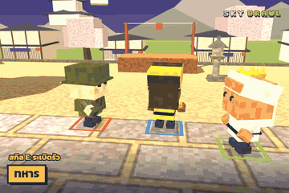</td>
<td>

**ทหาร** · ระยะไกล · ความยาก ★☆☆

🌀 **สกิล E:** ขว้างระเบิดรัว 5 ลูกใส่ศัตรูที่ใกล้ที่สุด<br>
👍 ไม่ต้องเล็ง ระเบิดเป็นวง ไม่โดนตัวเอง<br>
👎 ระเบิดมีจังหวะตก คนวิ่งหลบได้<br>
💡 ใช้ตอนศัตรูกำลังลุกขึ้นหรือมึนอยู่ จะโดนเกือบครบทุกลูก

</td>
</tr>
</table>

</details>

<details>
<summary><b>🔮 เวทย์</b> (8 อาชีพ)</summary>

<table>
<tr>
<td width="260">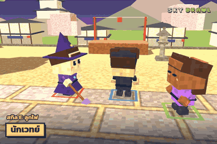</td>
<td>

**นักเวทย์** · เวทย์ · ความยาก ★☆☆

🌀 **สกิล E:** ยิงลูกไฟที่ระเบิดเป็นวง<br>
👍 ยิงไกล 10 ช่อง ระเบิดโดนหลายคน มือใหม่ใช้ง่าย<br>
👎 ตัวบาง ถ้าโดนประชิดต้องหนี<br>
💡 ยิงใส่กลุ่มที่กำลังตีกันอยู่ ได้ดาเมจฟรี

</td>
</tr>
<tr>
<td width="260">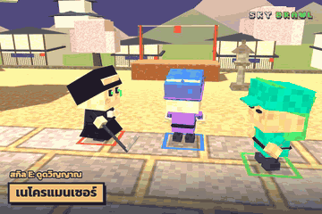</td>
<td>

**เนโครแมนเซอร์** · เวทย์ · ความยาก ★★☆

🌀 **สกิล E:** ยิงวิญญาณ ดาเมจที่ทำได้ดูดกลับเป็นเลือด<br>
👍 ตียาวและฟื้นเลือดไปพร้อมกัน ยืนระยะได้นาน<br>
👎 ดาเมจต่อนัดไม่สูง ต้องยิงให้โดนบ่อย<br>
💡 ใช้ Q ล็อกเป้าแล้วค่อยกด E ยิงให้แม่น

</td>
</tr>
<tr>
<td width="260">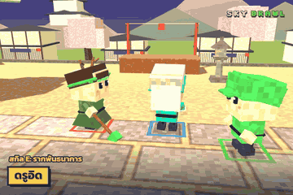</td>
<td>

**ดรูอิด** · เวทย์ · ความยาก ★★☆

🌀 **สกิล E:** รากไม้มัดทุกคนรอบตัว 1.3 วิ<br>
👍 ควบคุมฝูงชน มัดแล้วต่อคอมโบได้ทั้งวง<br>
👎 ระยะสั้น ต้องรอให้ศัตรูเข้ามาใกล้<br>
💡 มัดแล้วตีคนที่อยู่ใกล้ขอบเวทีก่อน ส่งตกได้ง่าย

</td>
</tr>
<tr>
<td width="260">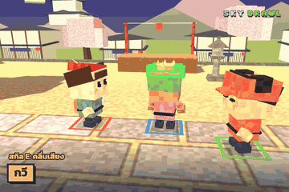</td>
<td>

**กวี** · เวทย์ · ความยาก ★★☆

🌀 **สกิล E:** คลื่นเสียงผลักทุกคนรอบตัวกระเด็นไกล<br>
👍 ผลักคนตกเวทีเก่ง เอาตัวรอดตอนโดนรุม<br>
👎 ดาเมจจากสกิลน้อย เน้นผลักมากกว่าฆ่า<br>
💡 ยืนกลางเวที รอให้คนรุมแล้วกด E ส่งออกนอกขอบ

</td>
</tr>
<tr>
<td width="260">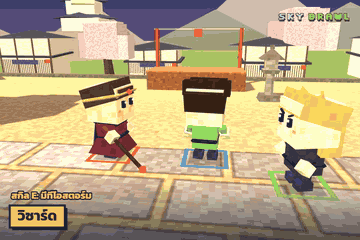</td>
<td>

**วิซาร์ด** · เวทย์ · ความยาก ★★☆

🌀 **สกิล E:** เรียกอุกกาบาต 5 ลูกถล่มรอบศัตรูที่ใกล้ที่สุด<br>
👍 ดาเมจวงกว้างแรง ตีกลุ่มดีมาก<br>
👎 คูลดาวน์ 11 วิ อุกกาบาตตกช้า คนหลบทัน<br>
💡 ใช้ตอนศัตรูกำลังตีกันเองหรือโดนมัดอยู่

</td>
</tr>
<tr>
<td width="260">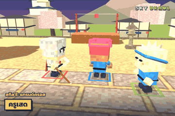</td>
<td>

**ครูเสด** · เวทย์ · ความยาก ★★★

🌀 **สกิล E:** เสียพลัง 6 ปล่อยแสงกางเขนสี่ทิศ ซัดทุกคนในแนวลอย<br>
👍 ตีได้ 4 ทิศพร้อมกัน<br>
👎 ยากเพราะเสียเลือดทุกครั้งที่ใช้ และต้องจัดคนให้อยู่ในแนว<br>
💡 ยืนให้ศัตรูอยู่แนวตรงหรือแนวขวางของตัวเอง แล้วค่อยกด

</td>
</tr>
<tr>
<td width="260">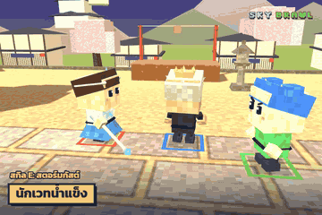</td>
<td>

**นักเวทน้ำแข็ง** · เวทย์ · ความยาก ★★☆

🌀 **สกิล E:** พายุน้ำแข็งวงกว้างตรงศัตรู แล้วแช่แข็งทั้งกลุ่ม<br>
👍 ควบคุมฝูงชนระยะไกล แช่แข็งได้ทีละหลายคน<br>
👎 พายุมีจังหวะก่อนแช่แข็ง ศัตรูอาจเดินออก<br>
💡 แช่แข็งแล้วรีบเข้าไปตีคนที่อยู่ใกล้ขอบก่อน

</td>
</tr>
<tr>
<td width="260">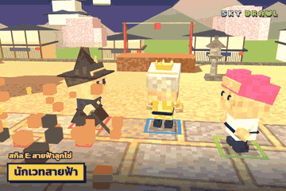</td>
<td>

**นักเวทสายฟ้า** · เวทย์ · ความยาก ★★☆

🌀 **สกิล E:** สายฟ้ากระโดดโดนศัตรูสูงสุด 4 คน ติดชา 3 วิ<br>
👍 ชาแล้วเดินช้า กระโดดไม่ได้ ไล่ตีง่าย<br>
👎 ดาเมจต่อคนไม่สูง<br>
💡 ช็อตแล้วไล่ตีคนที่ชาอยู่ เขาหนีไม่ได้และกระโดดหลบไม่ได้

</td>
</tr>
</table>

</details>

<details>
<summary><b>💚 ซัพพอร์ต</b> (2 อาชีพ)</summary>

<table>
<tr>
<td width="260">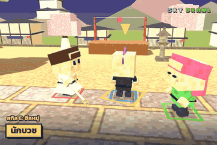</td>
<td>

**นักบวช** · ซัพพอร์ต · ความยาก ★☆☆

🌀 **สกิล E:** ฟื้นพลัง 35 ทันที<br>
👍 ฮีลก้อนใหญ่ 35 ยืนสู้ได้นานกว่าคนอื่น<br>
👎 ไม่มีสกิลโจมตี ต้องชนะด้วยคอมโบล้วน<br>
💡 อย่ารีบฮีล รอเลือดลดเกินครึ่งก่อนจะคุ้มที่สุด

</td>
</tr>
<tr>
<td width="260">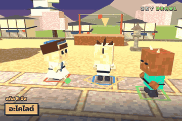</td>
<td>

**อะโคไลต์** · ซัพพอร์ต · ความยาก ★★☆

🌀 **สกิล E:** ฮีลเพื่อนที่เลือดน้อยที่สุดในระยะ 10 ช่อง<br>
👍 ตัวซัพพอร์ตของโหมดทีม คูลดาวน์สั้น 5 วิ<br>
👎 เล่นเดี่ยวได้แค่ฮีลตัวเอง ดาเมจน้อย<br>
💡 เล่นโหมดทีมตีหิน ยืนหลังเพื่อนสายประชิดแล้วฮีลเรื่อยๆ

</td>
</tr>
</table>

</details>

<details>
<summary><b>🐺 แปลงร่าง / อัญเชิญ</b> (6 อาชีพ)</summary>

<table>
<tr>
<td width="260">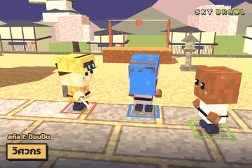</td>
<td>

**วิศวกร** · แปลงร่าง / อัญเชิญ · ความยาก ★★☆

🌀 **สกิล E:** วางป้อมปืนยิงศัตรูเอง 8 วินาที<br>
👍 ป้อมช่วยตีอยู่ตลอด เหมือนมีเพื่อนเพิ่ม 1 คน<br>
👎 คูลดาวน์ยาว 15 วิ ตัวเองไม่ได้แรง<br>
💡 วางป้อมใกล้จุดเกิดไอเทมหรือกลางเวที แล้วล่อศัตรูเข้ามา

</td>
</tr>
<tr>
<td width="260">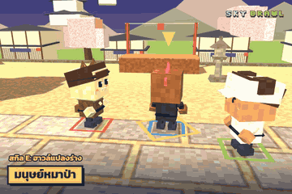</td>
<td>

**มนุษย์หมาป่า** · แปลงร่าง / อัญเชิญ · ความยาก ★★☆

🌀 **สกิล E:** แปลงร่างหมาป่า 8 วิ วิ่งเร็ว ตะปบวงกว้าง<br>
👍 ช่วงแปลงร่างไล่ล่าเก่งมาก ตะปบโดนรอบตัว<br>
👎 กลับร่างแล้วต้องรอคูลดาวน์อีก 14 วิ ร่างคนปกติไม่ได้เด่น<br>
💡 ใช้ร่างหมาป่าวิ่งไล่ตีสายยิงไกลที่อยู่ห่างกลุ่ม

</td>
</tr>
<tr>
<td width="260">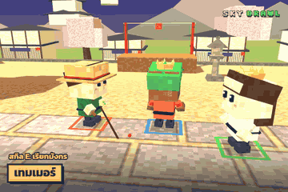</td>
<td>

**เทมเมอร์** · แปลงร่าง / อัญเชิญ · ความยาก ★★☆

🌀 **สกิล E:** แปลงเป็นมังกรยักษ์ 9 วิ พ่นไฟวงกว้างไกล<br>
👍 ร่างมังกรพ่นไฟโดนทั้งวง ใหญ่และโหด<br>
👎 ร่างมังกรเดินช้า กลับร่างแล้วรอคูลดาวน์อีก 16 วิ<br>
💡 แปลงตอนอยู่กลางเวทีที่คนเยอะ แล้วกดต่อยพ่นไฟค้างไว้

</td>
</tr>
<tr>
<td width="260">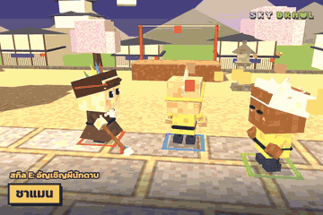</td>
<td>

**ชาแมน** · แปลงร่าง / อัญเชิญ · ความยาก ★☆☆

🌀 **สกิล E:** อัญเชิญผีนักดาบสู้ข้างตัว 10 วิ<br>
👍 ผีไล่ฟันเองแรงๆ ได้เหมือนเล่นสองตัว เหมาะมือใหม่<br>
👎 คูลดาวน์ 15 วิ ตัวเองไม่ได้แรง<br>
💡 เรียกผีแล้วเดินตามหลัง ให้ผีเปิดทางก่อน

</td>
</tr>
<tr>
<td width="260">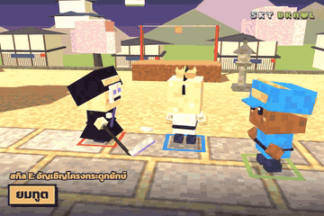</td>
<td>

**ยมทูต** · แปลงร่าง / อัญเชิญ · ความยาก ★★☆

🌀 **สกิล E:** เรียกโครงกระดูกยักษ์ทุบพื้นตรงศัตรู คนในวงมึน<br>
👍 มึนวงกว้างจากระยะไกล โครงกระดูกอยู่ช่วยต่อ<br>
👎 คูลดาวน์ 14 วิ มีจังหวะก่อนทุบ<br>
💡 ใช้ใส่กลุ่มที่กำลังรุมกันอยู่ แล้วเข้าไปเก็บคนที่มึน

</td>
</tr>
<tr>
<td width="260">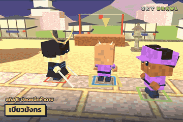</td>
<td>

**เบียวมังกร** · แปลงร่าง / อัญเชิญ · ความยาก ★★☆

🌀 **สกิล E:** ปลดผนึก 8 วิ ออร่าฟ้า ห้าดาบฟาดกวาดวงกว้าง<br>
👍 ช่วงแปลงร่างฟาดกว้างและเร็ว ท่าปิดหมุนห้าดาบซัดทุกคนลอย<br>
👎 กลับร่างแล้วรอคูลดาวน์อีก 14 วิ ร่างปกติเป็นนักดาบธรรมดา<br>
💡 แปลงร่างแล้วต่อยรัว ให้ครบท่าปิดหมุนห้าดาบ ทุกคนรอบตัวจะลอย

</td>
</tr>
</table>

</details>

> ตัวเลขทั้งหมด (คูลดาวน์ ระยะ ดาเมจ) ปรับได้ใน `config.js` รีวิวนี้เขียนตามค่าเริ่มต้นของเกม

---

---

## 🎮 ปุ่มควบคุม

**📱 มือถือ:** ลากนิ้วที่ครึ่งซ้ายของจอเพื่อเดิน ใช้ปุ่มด้านขวา (ต่อย · กระโดด · กัน · หยิบ · วิ่ง · สกิล · ล็อก) หมุนกล้องด้วยปุ่ม ⟲ ⟳ ด้านบน · หมุนจอแนวนอนจะเห็นสนามกว้างกว่า

**⌨️ คีย์บอร์ด**

| ผู้เล่น 1 | ผู้เล่น 2 (เครื่องเดียวกัน) | หน้าที่ |
|---|---|---|
| `W A S D` | `← ↑ → ↓` | เดิน |
| `F` | `,` หรือ `Num1` | ต่อย (กดรัว = คอมโบ 3 จังหวะ) |
| `G` / `Space` | `.` หรือ `Num2` | กระโดด |
| `H` (กดค้าง) | `/` หรือ `Num3` | กัน |
| `Shift` (กดค้าง) | `N` หรือ `Num7` (กดค้าง) | วิ่งเร็ว (มีแถบแรง) |
| `R` | `M` หรือ `Num0` | หยิบของ / ขว้างระเบิด / ขึ้น-ลงหุ่นรบ |
| `E` | `;` หรือ `Num4` | สกิลอาชีพ (ตอนเป็นวานรหรือขี่หุ่น = ลำแสง / ปืนกล) |
| `Q` | `'` หรือ `Num6` | ล็อกเป้า (กดซ้ำ = สลับเป้า) |

| ปุ่มอื่นๆ | หน้าที่ |
|---|---|
| `Z` / `C` (กดค้าง) · คลิกขวาลาก | หมุนกล้อง · `V` กลับมุมปกติ |
| `-` `=` · ล้อเมาส์ | ซูมกล้องเข้า-ออก |
| `Enter` | พิมพ์แชท |
| `1` – `8` | อีโมตเหนือหัว |
| `T` / `P` | ให้บอทเล่นแทนผู้เล่น 1 / ผู้เล่น 2 |
| `Esc` | เมนูหยุดเกม |

---

## ❓ คำถามที่พบบ่อย

<details>
<summary><b>ต้องสมัครหรือโหลดอะไรไหม?</b></summary>

ไม่ต้องเลย เปิดเว็บแล้วเล่นได้ทันที ถ้าอยากเก็บเลเวลและรางวัลรายวันไว้เล่นต่อทุกเครื่อง กด "ผูกบัญชี Google" ในเมนูได้
</details>

<details>
<summary><b>เล่นกับเพื่อนยังไง?</b></summary>

กด **เล่นออนไลน์** → **สร้างห้อง** → กด "ชวนเพื่อน" ส่งลิงก์ทาง LINE / Facebook / X หรือให้เพื่อนสแกน QR เพื่อนกดลิงก์แล้วเข้าห้องได้เลย ที่ว่างที่เหลือจะมีบอทมาเติมให้ครบ ห้องหนึ่งมีนักสู้ได้สูงสุด 128 คน (ผู้เล่นจริงสูงสุด 64 คน)
</details>

<details>
<summary><b>บอทที่คุยในแชทเป็นคนจริงไหม?</b></summary>

เป็นบอทครับ 😄 แต่ฉลาดพอจะตอบคำถาม เล่ามุก ถามกลับ และถ้าท้า 1v1 บอทจะวิ่งมาสู้กับคุณจริงๆ
</details>

<details>
<summary><b>เพื่อนเห็นห้องแต่เข้าไม่ได้ ทำยังไง?</b></summary>

เน็ตมือถือบางค่ายต่อกันตรงๆ ไม่ได้ เกมจะลองส่งผ่านเซิร์ฟเวอร์กลางให้อัตโนมัติ ถ้ายังเข้าไม่ได้ ลองสลับไปใช้ Wi-Fi หรือให้อีกคนเป็นคนสร้างห้อง (เจ้าของเว็บตั้งค่า TURN relay เพิ่มได้ใน `config.js` → `network`)
</details>

<details>
<summary><b>เล่นบนมือถือแล้วกระตุก</b></summary>

ลดจำนวนนักสู้ในหน้า "ตั้งค่าเกม" (8–16 คนลื่นที่สุด) ปิดแอปอื่น และหมุนจอแนวนอน
</details>

<details>
<summary><b>อยากให้มีอาชีพใหม่ ทำยังไง?</b></summary>

กรอก [แบบฟอร์มเสนออาชีพใหม่](templates/NEW_CLASS_TEMPLATE.md) (ดู[ตัวอย่างยมทูต](templates/EXAMPLE_REAPER.md)) แล้วส่งมาเป็น [Issue](https://github.com/Sky-Brawl/sky-brawl.github.io/issues) ได้เลย ช่องไหนไม่แน่ใจเว้นว่างไว้ ทีมจะปรับสมดุลให้
</details>

---

## 🛠️ สำหรับนักพัฒนา

<details>
<summary><b>โครงสร้างไฟล์ · รันบนเครื่อง · ตั้งค่า Supabase</b></summary>

เกมเป็นเว็บธรรมดา ไม่มีขั้นตอน build · โค้ดแยกเป็นไฟล์ย่อยตามหัวข้อในโฟลเดอร์ `js/` ดูว่าไฟล์ไหนทำอะไรได้ที่ [`js/README.md`](js/README.md)

| ไฟล์ | หน้าที่ |
|---|---|
| `index.html` | โครงหน้าเว็บ (เมนู ปุ่ม) + รายการไฟล์โค้ดตามลำดับโหลด |
| `style.css` | หน้าตาเมนูและ HUD |
| `js/` | โค้ดเกม แยกตามหัวข้อ (อาชีพ ด่าน บอท แชท พลังพิเศษ ออนไลน์ ฯลฯ) |
| `config.js` | ค่าที่ปรับได้โดยไม่ต้องแก้โค้ด: เลือด ความเร็ว คูลดาวน์/ดาเมจสกิล เปิด-ปิดอาชีพ บอทแชท ยาวานร หุ่นรบ |
| `supabase-*.sql` | ตารางโปรไฟล์ แชตล็อบบี้ เลเวล อันดับ รางวัลรายวัน ภารกิจรายวัน |
| `HANDOFF.md` | เอกสารโครงสร้างโค้ดและวิธีทำงานต่อ |
| `DEVLOG.md` | บันทึกการเปลี่ยนแปลงแต่ละเวอร์ชัน |
| `templates/` | แบบฟอร์มเสนออาชีพใหม่ + ตัวอย่าง + ฟอร์ม GitHub Issue |
| `promo/` · `media/classes/` | ภาพ/วิดีโอโปรโมต · GIF ท่าของแต่ละอาชีพ |
| `og.png` | รูปปกตอนแชร์ลิงก์ |
| `LICENSE.md` | ลิขสิทธิ์ เครดิตไลบรารีและฟอนต์ |

**เทคโนโลยี:** [Three.js r128](https://threejs.org/) (กราฟิก) · [PeerJS](https://peerjs.com/) (ออนไลน์แบบ host คำนวณเกม) · [Supabase](https://supabase.com/) (บัญชี ล็อบบี้ แชต เลเวล รางวัลรายวัน) · Web Audio (เสียงสังเคราะห์ทั้งหมด ไม่มีไฟล์เสียง)

**รันบนเครื่อง:** เปิดโฟลเดอร์นี้ด้วยเว็บเซิร์ฟเวอร์ใดก็ได้ เช่น

```bash
python -m http.server 8000
```

แล้วเข้า `http://localhost:8000/`

**ตั้งค่า Supabase (ถ้าใช้โปรเจกต์ของตัวเอง):** เปิด SQL Editor แล้วรัน `supabase-setup.sql` → `supabase-levels.sql` → `supabase-daily.sql` → `supabase-quests.sql` ตามลำดับ (รันซ้ำได้) แล้วแก้ `SUPA_URL` / `SUPA_KEY` ใน `js/account.js` เป็นของโปรเจกต์คุณ ในโค้ดใส่ได้แค่ **anon key** เท่านั้น ห้ามใส่ `service_role` key เด็ดขาด สิทธิ์การเขียนข้อมูลทั้งหมดคุมด้วย Row Level Security และฟังก์ชันฝั่งเซิร์ฟเวอร์

**อัปเดตบน GitHub:** ทุกครั้งที่แก้ไฟล์ ให้เปลี่ยนเลข `?v=` ในทุกแท็ก `<script>` และ `<link>` ของ `index.html` ไม่อย่างนั้นผู้เล่นบางคนจะได้ไฟล์เก่าจากแคช
</details>

---

## 📜 ลิขสิทธิ์

**Sky Brawl © 2026 SORADAD สงวนลิขสิทธิ์ (All rights reserved)**

- ✅ เล่นฟรี ดูโค้ด แชร์ลิงก์ ถ่ายภาพ ทำคลิป สตรีม รีวิว ได้เลย
- ❌ ห้ามคัดลอกไปเปิดเว็บเอง ดัดแปลงแล้วเผยแพร่ หรือใช้เชิงพาณิชย์ โดยไม่ได้รับอนุญาต
- ไลบรารี three.js, PeerJS, qrcode-generator, supabase-js (MIT) และฟอนต์ Kanit, Dela Gothic One, Silkscreen (SIL OFL 1.1) เป็นของเจ้าของแต่ละราย
- เกมแฟนเมดที่ได้แรงบันดาลใจจาก GetAmped และการ์ตูน/อนิเมะ ไม่มีความเกี่ยวข้องกับเจ้าของลิขสิทธิ์เหล่านั้น

อ่านฉบับเต็มที่ [LICENSE.md](LICENSE.md)

---

<div align="center">

### ชวนเพื่อนมาตะลุมบอนกัน! 👉 **[sky-brawl.github.io](https://sky-brawl.github.io/)**

[](https://sky-brawl.github.io/)

`#SkyBrawl` `#เกมออนไลน์` `#เกมฟรี` `#เกมมือถือ` `#เกมบนเว็บ`

<sub>© 2026 SORADAD · Sky Brawl สงวนลิขสิทธิ์</sub>

</div>
